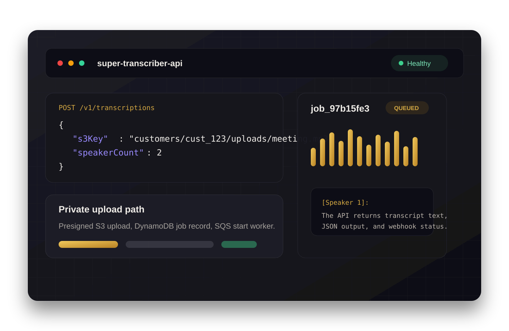

# Super Transcriber API

Super Transcriber API is a developer-facing transcription backend that turns the original Super Transcriber upload-and-transcribe workflow into a ready-to-integrate REST API. It uses TypeScript, Terraform, and AWS serverless services to accept private audio uploads, queue asynchronous Amazon Transcribe jobs, enforce customer usage limits, deliver transcripts by polling or webhook, and support optional Stripe-based monetization without fixed monthly application servers.

## Live Links

- Sales landing page: [https://super-transcriber-api.pages.dev](https://super-transcriber-api.pages.dev)
- Public API health: [https://pn72sppog0.execute-api.us-east-1.amazonaws.com/health](https://pn72sppog0.execute-api.us-east-1.amazonaws.com/health)
- Static API reference: [https://super-transcriber-api.pages.dev/api-reference](https://super-transcriber-api.pages.dev/api-reference)
- OpenAPI contract: [openapi/openapi.yaml](openapi/openapi.yaml)
- Architecture docs: [docs/architecture.md](docs/architecture.md)



## About

The original Super Transcriber was a consumer-facing web app for uploading audio and receiving transcripts. This repository packages the same core workflow as an API-first product for developers, internal tools teams, and companies that want transcription inside an existing product or AWS-native system. The hosted path exposes a clean REST API; the private-deployment path lets a customer deploy the same Terraform stack into their own AWS account.

## Tech Stack

| Area | Technology |
| --- | --- |
| Runtime | TypeScript, Node.js 20 Lambda, arm64 |
| API | API Gateway HTTP API, structured JSON errors, API-key auth |
| Async processing | SQS workers, Amazon Transcribe async jobs, EventBridge completion events |
| Data | DynamoDB single-table design, S3 private buckets, lifecycle retention |
| Billing and usage | Optional Stripe Checkout/Billing Portal, DynamoDB usage counters |
| Optional AI | Amazon Bedrock transcript enrichment, disabled by default |
| Infrastructure | Terraform only, no CDK, no VPC, no NAT Gateway, no RDS |
| Frontend/docs | Static Cloudflare Pages landing page and API reference |
| Quality | Vitest, TypeScript checks, Lambda bundling, Terraform validate, Checkov, CodeQL |

## Engineering Highlights

- Built a cost-first AWS serverless architecture with no always-on app servers, databases, NAT gateways, or VPC networking.
- Decoupled customer API requests from transcription side effects with SQS-backed workers and explicit job states: `PENDING_UPLOAD`, `QUEUED`, `STARTING`, `IN_PROGRESS`, `COMPLETED`, and `FAILED`.
- Implemented API-key authentication with SHA-256 hashed secrets, key-id lookup through DynamoDB GSI1, constant-time hash comparison, and no raw API-key logging.
- Enforced customer ownership and usage limits before starting Transcribe: active jobs, file size, duration, and monthly transcription minutes.
- Added production-shaped extension points: webhooks with signing secrets, optional Stripe self-serve billing, optional Bedrock enrichment, OpenAPI, and a TypeScript SDK.
- Managed observability and failure handling through Terraform-created CloudWatch log groups, SQS DLQs, and optional CloudWatch alarms.

## API Quickstart

The normal integration path is: create or claim an API key, presign an upload, upload audio to S3, start transcription with the returned `s3Key`, then poll or receive a webhook.

```bash
export API_BASE_URL="https://pn72sppog0.execute-api.us-east-1.amazonaws.com"
export API_KEY="stapi_example_key"
```

Presign an upload.

```bash
curl -sS -X POST "$API_BASE_URL/v1/uploads/presign" \
  -H "x-api-key: $API_KEY" \
  -H "content-type: application/json" \
  -d '{"fileName":"meeting.mp3","contentType":"audio/mpeg","fileSizeBytes":1048576}'
```

Upload the file with the returned `uploadUrl`.

```bash
curl -X PUT "$UPLOAD_URL" \
  -H "content-type: audio/mpeg" \
  --upload-file ./meeting.mp3
```

Start transcription with the returned `s3Key`.

```bash
curl -sS -X POST "$API_BASE_URL/v1/transcriptions" \
  -H "x-api-key: $API_KEY" \
  -H "content-type: application/json" \
  -d '{"s3Key":"customers/cust_123/uploads/job_123/meeting.mp3","fileName":"meeting.mp3","durationSeconds":600,"speakerCount":2}'
```

Poll and list jobs.

```bash
curl -sS "$API_BASE_URL/v1/transcriptions/$JOB_ID" -H "x-api-key: $API_KEY"
curl -sS "$API_BASE_URL/v1/transcriptions?limit=20" -H "x-api-key: $API_KEY"
```

Use the TypeScript SDK.

```ts
import { SuperTranscriberClient } from "@super-transcriber/api-client";

const client = new SuperTranscriberClient({
  baseUrl: process.env.API_BASE_URL!,
  apiKey: process.env.SUPER_TRANSCRIBER_API_KEY!
});

const presign = await client.presignUpload({
  fileName: "meeting.mp3",
  contentType: "audio/mpeg",
  fileSizeBytes: 1048576
});

await client.uploadFile(presign, audioBlob);
const job = await client.createTranscription({
  s3Key: presign.s3Key,
  fileName: "meeting.mp3",
  durationSeconds: 600,
  speakerCount: 2
});
```

Configure a completion webhook.

```bash
curl -sS -X POST "$API_BASE_URL/v1/webhooks" \
  -H "x-api-key: $API_KEY" \
  -H "content-type: application/json" \
  -d '{"url":"https://example.com/webhooks/super-transcriber","events":["transcription.completed","transcription.failed"]}'
```

## Architecture

Requests enter through API Gateway HTTP API and route to small Lambda handlers. Private audio uploads go directly to S3 through presigned URLs. Job creation writes DynamoDB records, reserves usage, validates S3 ownership, and sends a durable SQS message. A worker Lambda starts Amazon Transcribe asynchronously. EventBridge receives Transcribe completion events, invokes the completion Lambda, updates DynamoDB, and queues webhook delivery or optional Bedrock enrichment.

See [docs/architecture.md](docs/architecture.md) for the C4-style Mermaid diagram, runtime flow, deployment shape, single-table access patterns, and key constraints. See [docs/adrs](docs/adrs) for the core architecture decisions.

## Deployment Model

The AWS backend is deployed with Terraform from [terraform](terraform). Terraform manages API Gateway, Lambda, IAM, DynamoDB, S3, SQS, EventBridge, CloudWatch log groups, optional alarms, and optional Secrets Manager references for admin and Stripe secrets.

```bash
cd lambda
npm ci
npm run build
npm test
npm run bundle

cd ../terraform
terraform init
terraform apply
```

The static sales landing page is deployed separately from [landing](landing) to Cloudflare Pages. It is not required for the AWS API runtime.

## Cost Controls

- No VPC, NAT Gateway, RDS, OpenSearch, provisioned DynamoDB capacity, or fixed monthly compute.
- Lambda, API Gateway, SQS workers, and optional Bedrock enrichment run only on request or event volume.
- DynamoDB uses on-demand capacity.
- S3 buckets are private and use lifecycle expiration for uploads and transcript JSON.
- Stripe is optional and disabled unless Stripe secret ARNs and price ids are configured.
- Default free/dev limits are 5 active jobs, 200 MB files, 20 minute audio duration, and 120 monthly transcription minutes.

## Security And Privacy Model

- API keys are returned once, stored only as SHA-256 hashes, and looked up by key id instead of table scans.
- Customer job access is scoped by `customerId`; handlers validate ownership for jobs and uploaded S3 keys.
- S3 public access is blocked; customers upload only through presigned PUT URLs.
- Webhook payloads are HMAC-signed.
- Errors use structured JSON: `{ "success": false, "error": "...", "code": "..." }`.
- Each Lambda has its own IAM role, and Terraform manages log groups with retention.

## Local Validation

```bash
cd lambda
npm ci
npm run build
npm test
npm run bundle

cd ../sdk/typescript
npm ci
npm run build

cd ../../terraform
terraform fmt -check -recursive
terraform init -backend=false
terraform validate

cd ..
git diff --check
```

## Project Structure

```text
.
|-- docs/                  # Architecture, API, operations, validation evidence, ADRs
|-- landing/               # Static Cloudflare Pages sales site and API reference
|-- lambda/                # TypeScript Lambda handlers, shared modules, tests, bundler
|-- openapi/               # OpenAPI 3.1 contract
|-- sdk/typescript/        # TypeScript API client
|-- terraform/             # AWS infrastructure as Terraform
`-- .github/               # CI and optional AWS deployment workflow example
```

## CI And Deployment Status

The active CI workflow installs Lambda and SDK dependencies, runs TypeScript checks, executes Vitest unit tests, audits npm dependencies, bundles Lambda zip files, runs Terraform formatting, initializes Terraform without a backend, validates Terraform, runs a soft-fail Checkov IaC scan, runs GitHub dependency review on PRs, runs CodeQL, and checks whitespace. AWS deployment is not active by default; an optional manual AWS deployment workflow is stored under [.github/examples](.github/examples).

## Implemented

- API-key creation and hashed API-key authentication
- Presigned S3 uploads for MP3 and M4A files
- SQS-backed asynchronous transcription starts
- Amazon Transcribe speaker diarization
- DynamoDB job storage, usage counters, and cursor pagination
- Job polling, transcript retrieval, soft deletion, and completion handling
- Webhook configuration and delivery
- Optional Stripe Checkout, billing claim, Billing Portal, and Stripe webhook handling
- Optional Bedrock transcript enrichment
- Terraform-managed AWS serverless infrastructure
- OpenAPI contract, TypeScript SDK, unit tests, CI, and static sales site

## Limitations

- Direct `sourceUrl` ingestion is not implemented in v1; it returns `501 NOT_IMPLEMENTED`.
- Stripe billing and Bedrock enrichment are disabled unless the required Terraform variables and AWS/Stripe configuration are provided.
- API Gateway HTTP API does not support REST API usage plans, so this project uses Lambda-side per-customer usage counters and stage throttling.

©2026 SUPREME AI VENTURES LLC
