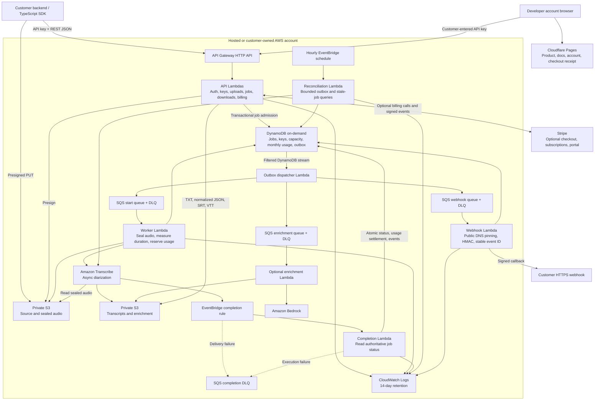

# Architecture

Super Transcriber API separates the REST control plane from private media processing. Hosted customers integrate with HTTP or the TypeScript SDK. Private customers deploy the same Terraform stack into their AWS account. Cloudflare Pages provides static product/docs/account pages; all transcription, key, usage, and billing processing runs in AWS Lambda.

## C4-Style Container Diagram



## Runtime Flow

1. A customer requests a presigned MP3/M4A upload. The API stores the job/mapping with a retention TTL and returns the PUT URL, headers, job ID, and start request.
2. Audio goes directly to private S3. The transcription route checks the owned key and object size/ETag.
3. A DynamoDB transaction queues the job, reserves global customer concurrency, and writes a durable start event. Repeating the same upload/settings returns the existing job.
4. A filtered stream dispatcher sends the event to SQS and marks it dispatched. If sending fails, the pending event remains recoverable.
5. A leased worker copies the accepted ETag into a processing-only S3 path, streams it to temporary disk, parses MP3/M4A metadata, and enforces actual duration. Clients cannot overwrite the sealed object with their upload URL.
6. Before Transcribe starts, a transaction reserves measured, rounded-up seconds against the monthly limit. Invalid media or insufficient minutes produces a FAILED job and releases concurrency.
7. Transcribe reads sealed audio and writes private transcript JSON. Completion reads authoritative Transcribe status and atomically updates the job, releases concurrency, settles/refunds minutes, and records callback/optional enrichment events.
8. Webhook workers sign a stable payload identity, pin a validated public DNS address, and deliver without redirects. Attempts are recorded for customer inspection and replay.
9. Customers poll lightweight metadata or download TXT, normalized JSON, SRT, or VTT. Speaker labels, timestamps, and confidence derive from the Transcribe output.
10. Hourly reconciliation retries pending events and checks stale jobs. Checks are bounded to 100 records per category, and the checked timestamp advances to avoid starving other active jobs.

## Lifecycle And Failure Semantics

```text
PENDING_UPLOAD -> QUEUED -> STARTING -> IN_PROGRESS -> COMPLETED
                         \-> FAILED
```

A worker lease prevents simultaneous starts. The Transcribe job name is stable across retries, so a successful start followed by an interrupted response can be recovered. Transactions prevent partial usage settlement. SQS/event delivery remains at least once; callback receivers must deduplicate stable event IDs. A 24-hour job deadline bounds stuck capacity, while Lambda execution failures and EventBridge delivery failures are separately routed to a DLQ.

Job admission checks active concurrency. Actual duration and monthly minutes are enforced asynchronously before the billable Transcribe call. Customers can therefore receive 202 and then a FAILED quota/validation result. Caller duration hints never determine new-job consumption.

## Single-Table Access Patterns

| Record | PK | SK / index | Purpose |
| --- | --- | --- | --- |
| Customer | `CUSTOMER#{id}` | `METADATA` | Plan, billing, manual limits |
| API key | `CUSTOMER#{id}` | `APIKEY#{keyId}`; GSI1 key-id lookup | Hash, prefix, scopes, status |
| Job | `CUSTOMER#{id}` | `JOB#{jobId}`; GSI2 recent jobs | Owned state and output pointers |
| Active job | Same job record | GSI1 `ACTIVE#JOBS` / last check | Bounded recovery |
| Capacity | `CUSTOMER#{id}` | `CAPACITY` | Active jobs across month boundaries |
| Monthly usage | `CUSTOMER#{id}` | `USAGE#{yyyy-mm}` | Reserved/consumed seconds and outcomes |
| Transcribe mapping | `TRANSCRIBE#{name}` | `JOB` | Completion lookup |
| Outbox | `OUTBOX#{stableEventId}` | `EVENT`; GSI1 `OUTBOX#PENDING` | Durable start/callback/enrichment intent |
| Webhook | `CUSTOMER#{id}` | `WEBHOOK#default` | URL, signing secret, events |
| Delivery | `CUSTOMER#{id}` | `DELIVERY#{jobId}#{eventId}` | Attempts and replay eligibility |
| Enrichment | `CUSTOMER#{id}` | `ENRICHMENT#{jobId}` | Optional output/status |
| Checkout receipt | `BILLING_SESSION#{secretToken}` | `METADATA` | Paid claim/recovery; 24-hour eligibility |
| Request rate | `KEYRATE#{keyId}` | UTC minute; TTL | Fixed-window per-key rate limit |

API-key lookup uses GSI1, followed by a consistent base-table read to enforce revocation. Customer plan limits are evaluated at authentication rather than frozen on paid keys. Job admission snapshots the applicable limits for the accepted work. Runtime handlers do not scan the table.

## Deployment And Constraints

Terraform manages API Gateway, 23 Node.js 24 arm64 Lambdas, separate IAM roles, DynamoDB/Streams, private S3, SQS, EventBridge, log groups, and optional alarms/secret references. State is encrypted in S3 with native lock files; environments use separate state keys. A plan guard rejects deletions/replacements before applying.

The hosted deployment enables SQS consumers. Dev/local defaults can pause them, while stream/outbox recovery keeps event intent durable. A paused API cannot complete transcription until workers resume.

No VPC, NAT Gateway, RDS, provisioned DynamoDB capacity, or always-on compute is required. The idle budget target is below $3/month, not a billing guarantee. Active transcription, requests, storage, and optional enrichment incur usage charges.

Default retention: audio 7 days; transcripts/enrichment and new job/mapping TTL 30 days; logs 14 days; dispatched events 7 days; delivery history 30 days. S3 lifecycle/DynamoDB TTL deletion is asynchronous. Explicit permanent purge waits for processing and upload-link expiry before removing media and job data.

Stripe and Bedrock remain disabled unless configured. MP3/M4A are supported; source URL ingestion and real-time streaming are not implemented. Older jobs retain their original metadata; verified metering applies to new submissions.
