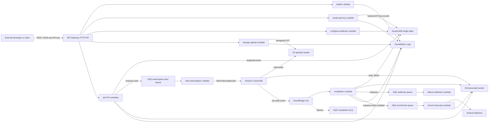
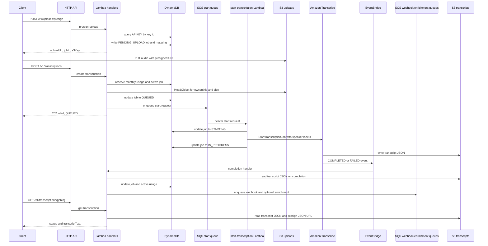

# Architecture

Super Transcriber API is intentionally serverless: API Gateway HTTP API, Lambda, DynamoDB, S3, SQS, Amazon Transcribe, EventBridge, optional Amazon Bedrock, and CloudWatch Logs. Terraform is the only active infrastructure path.

## Container Diagram

## Runtime Flow

## Single-Table Access Patterns

| Record | PK | SK | Purpose |
| --- | --- | --- | --- |
| Customer metadata | `CUSTOMER#{customerId}` | `METADATA` | Customer profile |
| API key | `CUSTOMER#{customerId}` | `APIKEY#{keyId}` | Hashed API key and limits |
| Job | `CUSTOMER#{customerId}` | `JOB#{jobId}` | Job status and ownership |
| Transcribe mapping | `TRANSCRIBE#{transcribeJobName}` | `JOB` | Completion event lookup |
| Webhook | `CUSTOMER#{customerId}` | `WEBHOOK#default` | Completion webhook URL, events, and signing secret |
| Enrichment | `CUSTOMER#{customerId}` | `ENRICHMENT#{jobId}` | Optional Bedrock enrichment status and output location |
| Monthly usage | `CUSTOMER#{customerId}` | `USAGE#{yyyy-mm}` | Active jobs and reserved seconds |

GSI1 maps `APIKEY#{keyId}` to the API key record without scans. GSI2 maps `JOBS#{customerId}` to recent jobs by `createdAt#jobId` for cursor pagination.

## Cost-First Constraints

The stack avoids fixed monthly network and database services. There is no VPC, NAT Gateway, RDS, provisioned DynamoDB capacity, or always-on worker. SQS workers are event driven and scale to zero. Optional Bedrock enrichment is disabled by default. Rate and usage control live in API Gateway stage throttles plus Lambda-side customer counters. AWS API Gateway usage plans are documented for REST APIs, while this stack uses HTTP API for lower cost and simpler routing.
