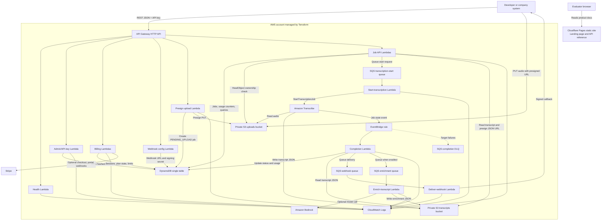
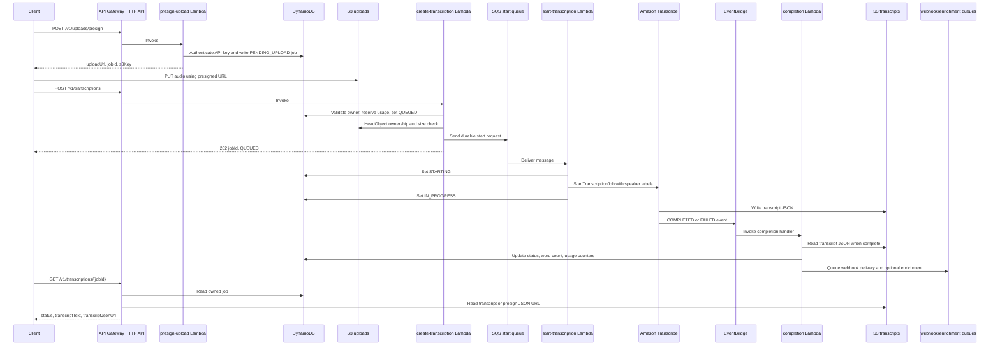

# Architecture

Super Transcriber API is a cost-first, serverless transcription API. The customer-facing control plane is REST over API Gateway HTTP API. The data plane keeps media private by uploading audio directly to S3 with presigned URLs, then processing transcription asynchronously through SQS, Amazon Transcribe, EventBridge, and Lambda. Terraform is the only active infrastructure-as-code path for the AWS backend. Cloudflare Pages hosts only the static sales page and API reference.

## C4-Style Container Diagram

## Runtime Flow

## Deployment Shape

- AWS backend: deployed from [terraform](../terraform) into an AWS account with Terraform-managed API Gateway, Lambda, IAM, DynamoDB, S3, SQS, EventBridge, CloudWatch Logs, optional alarms, and optional Secrets Manager references.
- Static site: deployed from [landing](../landing) to Cloudflare Pages. It hosts marketing content and API reference only; it is not required for transcription processing.
- CI: GitHub Actions runs Lambda TypeScript checks, Vitest, Lambda bundling, SDK build, Terraform fmt/init/validate, npm audit, Checkov, CodeQL, dependency review, and whitespace checks.
- Private deployment path: customers can deploy the same Terraform stack into their own AWS account and keep uploaded media, transcripts, DynamoDB records, and logs in their account.

## Single-Table DynamoDB Model

| Record | PK | SK | Purpose |
| --- | --- | --- | --- |
| Customer metadata | `CUSTOMER#{customerId}` | `METADATA` | Customer profile, plan, billing state |
| API key | `CUSTOMER#{customerId}` | `APIKEY#{keyId}` | Hashed key, display prefix, limits |
| Billing session | `BILLING_SESSION#{claimToken}` | `METADATA` | Stripe Checkout claim state with TTL |
| Job | `CUSTOMER#{customerId}` | `JOB#{jobId}` | Status, ownership, file metadata, output pointers |
| Transcribe mapping | `TRANSCRIBE#{transcribeJobName}` | `JOB` | Completion-event lookup |
| Webhook | `CUSTOMER#{customerId}` | `WEBHOOK#default` | URL, events, signing secret |
| Enrichment | `CUSTOMER#{customerId}` | `ENRICHMENT#{jobId}` | Optional Bedrock enrichment status and output |
| Monthly usage | `CUSTOMER#{customerId}` | `USAGE#{yyyy-mm}` | Active jobs and reserved seconds |

GSI1 maps `APIKEY#{keyId}` to an API-key record without scanning and maps `STRIPE_CUSTOMER#{stripeCustomerId}` to customer metadata for billing webhooks. GSI2 maps `JOBS#{customerId}` to recent jobs by `createdAt#jobId` for cursor pagination.

## Key Constraints

- No VPC, NAT Gateway, RDS, OpenSearch, provisioned DynamoDB capacity, or always-on workers.
- Lambda runtime is Node.js 20 on arm64.
- API Gateway uses HTTP API for lower cost; REST API usage plans are not used.
- Rate and quota control combine API Gateway stage throttles with Lambda-side per-customer usage counters.
- S3 buckets are private, public access is blocked, and upload access is presigned.
- Stripe billing and Bedrock enrichment are optional and disabled unless configured.
- `sourceUrl` transcription is intentionally not implemented in v1; clients upload to owned S3 keys first.
